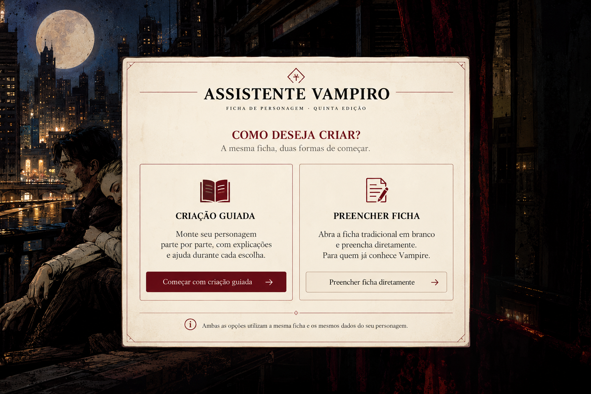
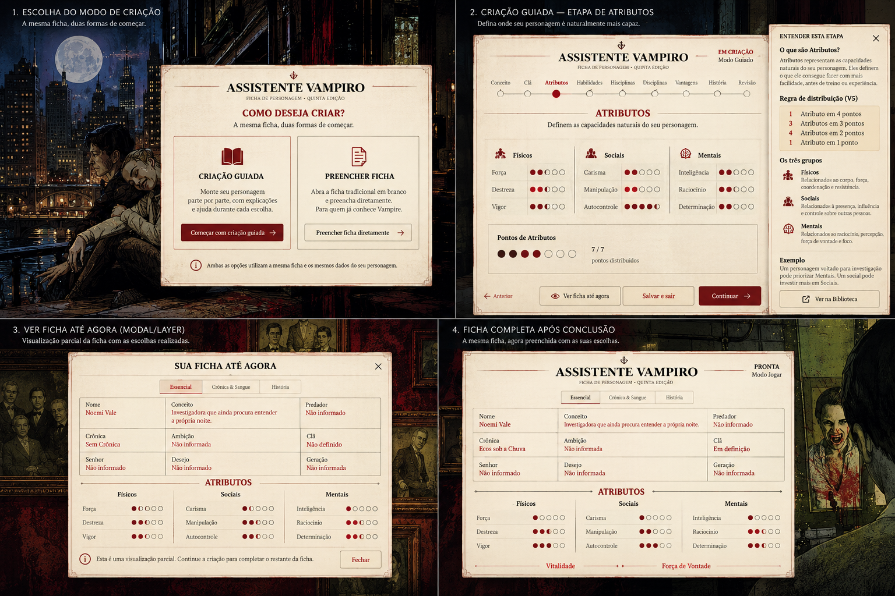
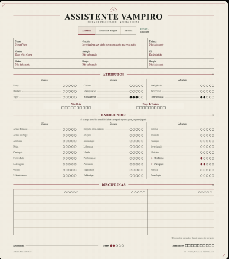
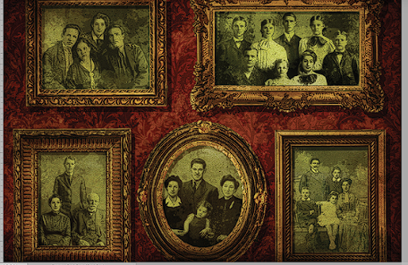
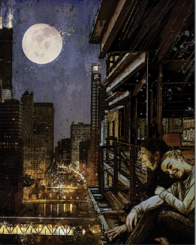
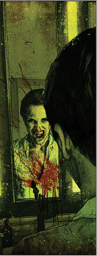

# Character Creation — Visual & UX Specification v0.2

**Status:** APROVADO COMO BASE VISUAL E DE INTERAÇÃO  
**Superfície:** Criação de Personagem / Ficha em construção  
**Produto:** Assistente Vampiro  
**Edição inicial:** V5  
**Substitui:** `character-creation-visual-ux-spec-v0.1.md`  
**Política complementar:** `documentacao/03-dominio-regras/politica-validacao-criacao-personagem-v0.1.md`

> Esta versão inclui os **assets visuais aprovados** para impedir que a implementação derive composição, atmosfera ou hierarquia apenas de descrição textual.

---

# 1. Regra de leitura para implementação

O Codex deve usar este documento em conjunto com:

- a Ficha existente no código;
- `documentacao/02-design-experiencia/calibracoes/character-gateway-visual-spec-v0.1.md`;
- `documentacao/02-design-experiencia/assets/calibracoes/character-gateway-visual-v01.png`;
- `documentacao/02-design-experiencia/identidade-visual-direcao-arte-v0.1.md`;
- `documentacao/02-design-experiencia/sistema-arte-arquetipos-tela-v0.2.md`;
- a política de validação da criação.

As imagens abaixo têm **hierarquia explícita**.

Não escolher arbitrariamente entre versões.

---

# 2. Hierarquia dos assets

## A01 — Escolha do modo de criação — APROVADA



**Estado:** APROVADO INTEGRALMENTE COMO COMPOSIÇÃO.

Esta é a referência principal para:

- centralização do documento;
- proporção da superfície clara;
- quantidade de arte visível nas margens;
- hierarquia entre título, escolhas e mensagem de confiança;
- relação entre fundo escuro e Ficha clara;
- equilíbrio entre `Criação Guiada` e `Preencher Ficha`.

### Congelado

- documento/ficha centralizado horizontalmente;
- área clara como objeto principal;
- fundo visível nas duas laterais;
- fundo nunca deve empurrar a Ficha para um canto;
- duas escolhas com peso equivalente;
- CTA principal da criação guiada pode receber maior ênfase;
- baixa densidade;
- sem dashboard.

### Não copiar literalmente

A arte de fundo deste mockup é apenas referência de enquadramento e atmosfera.  
A produção deve utilizar arte aprovada/licenciada/original segundo a direção artística do projeto.

---

## A02 — Criação guiada / preview / conclusão — REFERÊNCIA APROVADA PARCIAL



**Estado:** PAINÉIS 2, 3 E 4 APROVADOS COMO DIREÇÃO.  
**Painel 1 está SUPERADO pelo A01.**

Usar somente como referência para:

### Painel 2 — Criação Guiada

Aprovado:

- Ficha clara permanece protagonista;
- navegação de etapas editorial e discreta;
- região mecânica da etapa no centro;
- painel lateral direito dedicado a ajuda;
- lateral contém:
  - explicação conceitual;
  - regra mecânica da etapa;
  - distribuição/orçamento;
  - progresso restante;
  - aprofundamento;
- controles inferiores:
  - anterior;
  - entender esta etapa;
  - ver ficha até agora;
  - salvar e sair;
  - continuar.

**Regra:** a criação guiada precisa guiar também mecanicamente.  
Não basta explicar o que é um Atributo; a tela deve informar quanto pode ser distribuído, o que resta e por que uma escolha é ou não permitida.

Os números mostrados no mockup são ilustrativos.  
Valores reais vêm de política estruturada e versionada do backend.

### Painel 3 — Ver ficha até agora

Aprovado:

- modal/layer editorial;
- mesma Ficha tradicional;
- dados parciais reais;
- ausência de campos representada honestamente;
- não criar cópia independente de estado;
- fechar retorna à mesma etapa.

### Painel 4 — Conclusão

Aprovado como transição conceitual:

- a criação não termina em uma tela de “Parabéns”;
- a própria Ficha passa de `EM CRIAÇÃO` para `PRONTA / Modo Jogar`;
- o conteúdo preenchido permanece na Ficha final.

**Atenção:** o painel 4 do mockup é simplificado. A estrutura definitiva da Ficha completa é A03.

---

## A03 — Ficha completa — APROVADA



**Estado:** APROVADO COMO REFERÊNCIA DA FICHA FINAL.

A Ficha completa já possui linguagem própria aprovada.

Ela é referência para:

- composição editorial;
- cabeçalho;
- abas;
- identificação;
- Atributos;
- derivados;
- Habilidades;
- Disciplinas;
- trilhas;
- densidade de informação;
- linhas, espaçamento e dots;
- aparência de ficha tradicional.

### Regra fundamental

A Criação Guiada **não redesenha a Ficha final**.

Ela revela e edita partes dessa mesma linguagem progressivamente.

`Preencher Ficha` abre diretamente essa superfície em branco/editável.

### Invariante das escalas V5

Atributos, Habilidades, Disciplinas e toda futura representação de traço graduado da Ficha V5 exibem sempre cinco posições. Limites próprios da criação controlam quais posições podem ser escolhidas, mas nunca encurtam visualmente a escala. Posições temporariamente indisponíveis continuam visíveis, distinguíveis e acessíveis como bloqueadas.

---

# 3. Continuidade com o Character Gateway

Antes desta criação existe o Character Gateway já aprovado no repositório.

A transição deve parecer:

```text
Character Gateway
noite / pintura / atmosfera
        ↓
Criar personagem
        ↓
ambiente escuro permanece
        +
Ficha clara aparece como documento central
```

Não deve parecer:

```text
aplicativo escuro
        ↓
outro site branco sem relação
```

A continuidade deve vir de:

- Ankh canônico;
- mesma família tipográfica definida pelo Design System;
- mesmo oxblood;
- mesma disciplina de espaço;
- mesmo nível de acabamento;
- arte pictórica com personalidade;
- transição coerente.

---

# 4. Referências temáticas de fundo

As imagens B01–B03 são **referências artísticas/moodboard**.

Elas não autorizam automaticamente uso como assets de produção.  
Antes de incorporar qualquer obra diretamente ao produto, verificar procedência e direitos.

O objetivo destas referências é orientar **tema, enquadramento, densidade e emoção**.

---

## B01 — Linhagem / memória / passado



**Usar como referência para:**

- História;
- Senhor;
- Geração;
- linhagem;
- memórias;
- relações antigas;
- arquivos de família/ancestralidade.

**Qualidade desejada:**

- sensação de passado;
- objeto com história;
- decadência;
- memória observando o personagem;
- textura real e imperfeição.

**Não usar como identidade global de todas as etapas.**

---

## B02 — Cidade / noite / humanidade / intimidade



**Usar como referência para:**

- Conceito;
- Ambição;
- Desejo;
- identidade;
- entrada da criação;
- vínculo do personagem com a noite urbana.

**Qualidade desejada:**

- cidade contemporânea;
- melancolia;
- noite;
- intimidade;
- humanidade;
- sensação de viver dentro do Mundo das Trevas.

Esta referência é particularmente importante para impedir que o produto fique excessivamente “gótico antigo”.

---

## B03 — Horror íntimo / Besta / Fome



**Usar como referência para:**

- Fome;
- Predador;
- monstruosidade;
- Besta;
- perda de controle;
- conflito entre aparência e natureza.

**Qualidade desejada:**

- horror pessoal;
- desconforto;
- reflexo;
- violência sugerida;
- tensão.

Evitar transformar essa linguagem em sangue decorativo constante.

---

# 5. Gramática artística única

Os fundos podem variar entre etapas.

A identidade NÃO depende de repetir a mesma arte.

A identidade depende de uma gramática comum:

1. composição pictórica;
2. aparência humana/manual;
3. assimetria;
4. detalhe seletivo;
5. uso de sombra;
6. vermelho como ruptura;
7. noite/cidade como base contemporânea;
8. terror psicológico em vez de ornamento;
9. Ficha clara funcionando como documento;
10. arte servindo a interface, nunca o contrário.

---

# 6. Referências artísticas principais

A direção artística do projeto continua fundamentada principalmente em:

## Amy Wilkins

Referência para:

- personagem;
- emoção;
- corpo;
- rosto;
- pincel;
- intimidade;
- horror humano.

## Michael Gaydos

Referência para:

- cena;
- enquadramento;
- narrativa;
- espaço negativo;
- cidade;
- atmosfera editorial.

## Referências secundárias VTM

Utilizar o Reference Board já versionado para referências complementares.

### Regra

Não pedir ou produzir cópia literal do estilo de artista vivo.

Extrair:

- princípios de composição;
- textura;
- narrativa;
- proporção;
- cor;
- presença humana;
- nível de acabamento.

---

# 7. Criação Guiada — regra de composição

A Criação Guiada deve ter três zonas.

```text
┌───────────────────────────────────────────────────────────────┐
│ FICHA / STATUS / PROGRESSO                                   │
├──────────────────────────────────────────┬────────────────────┤
│                                          │                    │
│ REGIÃO DA FICHA SENDO PREENCHIDA         │ AJUDA / REGRA      │
│                                          │ MECÂNICA / RESTANTE│
│                                          │                    │
├──────────────────────────────────────────┴────────────────────┤
│ voltar | entender | ver ficha | salvar | continuar            │
└───────────────────────────────────────────────────────────────┘
```

### Zona principal

Mostra apenas a parte da Ficha relevante à etapa.

### Lateral

Sempre deve responder:

1. **O que é isso?**
2. **Como funciona nesta criação?**
3. **Quanto já usei e quanto falta?**
4. **Onde posso entender melhor?**

### Fundo

A arte aparece nas bordas e áreas não funcionais.

Não atravessar texto nem controles.

---

# 8. Regras mecânicas no painel lateral

A lateral não deve ser um texto decorativo.

Exemplo conceitual para uma etapa:

```text
REGRA DESTA ETAPA

Distribuição permitida
[estrutura retornada pelo backend]

SEU PROGRESSO

Nível X      usado / permitido
Nível Y      usado / permitido
...

[Entender esta etapa]
[Ver na Biblioteca]
```

### Fonte dos valores

**Nunca hardcodar no React.**

Fluxo correto:

```text
Rule/Creation Policy versionada
        ↓
backend
        ↓
contrato estruturado
        ↓
frontend apresenta
```

Markdown/Biblioteca explica.  
Markdown não executa regra.

---

# 9. Feedback de bloqueio

Na Criação Guiada, se uma escolha viola a política da etapa:

- não aplicar a escolha;
- não abrir modal genérico;
- explicar junto ao campo;
- refletir a razão no painel lateral;
- preservar o restante da Ficha.

Exemplo:

> Você já utilizou a escolha disponível neste nível.

O backend valida novamente.

---

# 10. Preencher Ficha

`Preencher Ficha` usa A03 diretamente como base.

Características:

- Ficha inteira;
- inicialmente vazia;
- edição direta;
- mesma estética tradicional;
- ajuda opcional discreta;
- warnings sem travar cada interação;
- validação completa somente na conclusão do draft.

Não converter a experiência em wizard.

---

# 11. Conteúdo de ajuda e Markdown

Os documentos versionados podem alimentar:

- explicações;
- conceitos;
- dicas;
- glossário;
- exemplos;
- aprofundamento.

A UI deve possuir metadados/identificadores para abrir o conteúdo correto.

Não copiar grandes blocos de Markdown diretamente para a etapa.

Preferir:

```text
resumo autoral curto
      ↓
Entender esta etapa
      ↓
artigo/contexto maior
      ↓
Ver na Biblioteca
```

---

# 12. Política de validação

A implementação deve ler:

`documentacao/03-dominio-regras/politica-validacao-criacao-personagem-v0.1.md`

Resumo obrigatório:

- `CREATION_STEP`: estrito na regra da etapa, tolerante com ficha incompleta;
- `CREATION_FINALIZATION`: validação integral;
- `ONGOING_EDIT`: não reaplica distribuição inicial;
- `CHRONICLE_BINDING`: validação contextual futura.

Regra central:

> **Regra de criação não é regra eterna da Ficha.**

---

# 13. Símbolos

Não inventar simbologia.

Usar somente:

- Ankh canônico aprovado;
- símbolos canônicos/oficiais de clã quando aplicáveis e autorizados;
- iconografia funcional neutra.

Símbolos gerados em mockups NÃO são automaticamente aprovados.

---

# 14. O que NÃO fazer

Não:

- substituir A01 por versão antiga deslocada;
- usar o painel 1 do A02 como composição final;
- transformar a criação em dashboard;
- transformar o papel em uma UI escura;
- usar fundo genérico só para preencher espaço;
- colocar arte atrás de texto;
- misturar B01+B02+B03 simultaneamente;
- criar uma arte diferente sem relação para cada etapa;
- inventar números de regra;
- inventar símbolos;
- alterar A03 para “modernizar” a Ficha;
- misturar Quick Sheet/Mesa com a Ficha completa.

---

# 15. Critérios de aceite visual

A implementação visual só pode ser considerada aderente quando:

- [ ] A01 é respeitado na escolha de modo;
- [ ] documento está centralizado;
- [ ] arte lateral permanece visível;
- [ ] Ficha clara domina a área funcional;
- [ ] Criação Guiada mantém a gramática de A03;
- [ ] lateral combina conceito + mecânica + progresso;
- [ ] A02 painel 3 é respeitado no preview;
- [ ] conclusão revela A03, não uma ficha simplificada;
- [ ] fundos seguem famílias temáticas B01–B03;
- [ ] arte não compete com a interface;
- [ ] nenhuma simbologia fictícia foi introduzida;
- [ ] nenhum elemento de Mesa aparece.

---

# 16. Critérios para Codex antes de escrever UI

Antes de implementar a superfície:

1. abrir A01;
2. abrir A02 e considerar somente painéis 2–4;
3. abrir A03;
4. abrir B01–B03;
5. revisar Character Gateway aprovado;
6. revisar a política de validação;
7. identificar componentes existentes da Ficha;
8. apresentar qualquer conflito entre código atual e estas referências.

Se houver conflito, não escolher sozinho uma nova direção visual.

---

# 17. Manifesto de assets

| ID | Arquivo | Papel | Estado |
|---|---|---|---|
| A01 | `A01-mode-selection-approved.png` | escolha do modo | aprovado integral |
| A02 | `A02-guided-creation-panels-2-4-reference.png` | guided / preview / conclusão | painéis 2–4 aprovados |
| A03 | `A03-final-character-sheet-approved.png` | Ficha completa | aprovado |
| B01 | `B01-background-lineage-memory-reference.png` | linhagem/passado | referência temática |
| B02 | `B02-background-city-night-humanity-reference.png` | cidade/humanidade | referência temática |
| B03 | `B03-background-horror-beast-reference.png` | horror/Besta | referência temática |

---

# 18. Nota de direitos e produção

Os assets B01–B03 são material de referência fornecido para direção visual.

Antes de uso direto em produção:

- confirmar autoria;
- confirmar licença/permissão;
- registrar procedência.

Quando não houver autorização, produzir arte original/licenciada seguindo os princípios aprovados, sem copiar literalmente obra ou estilo de artista vivo.

---

# 19. Próximo incremento visual

Após esta especificação, o primeiro recorte a implementar visualmente deve ser:

```text
Character Gateway
     ↓
Novo
     ↓
A01 — Escolha de modo
     ↓
Criação Guiada
     ↓
primeira etapa real usando a Ficha + lateral mecânica
```

A primeira etapa pode ser definida após a política de criação V5 correspondente estar formalizada.

Nenhuma nova superfície de Mesa deve ser criada por este incremento.
