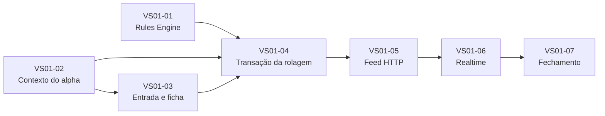

# Plano de Implementação do Vertical Slice 01 v0.1

**Status:** aprovado<br>
**Data:** 20 de outubro de 2026<br>
**Objetivo:** transformar o alpha técnico aprovado em entregas pequenas, integráveis e verificáveis<br>
**Base:** Product Architecture, Rules Engine Scope, Permissions Matrix, Architecture v0.1 e Engineering Foundation concluída

## 1. Resultado esperado

O Vertical Slice 01 prova um caminho completo e estreito:

```text
identidade fictícia controlada
→ personagem autorizado
→ Boa noite
→ ficha mínima
→ Roll Builder
→ regra resolvida no servidor
→ tentativa, evento e outbox na mesma transação
→ Feed autorizado
→ desconexão e retomada sem perda ou duplicação
```

O corte termina quando esse fluxo pode ser demonstrado por Jogador e Narrador,
com dados fictícios, PostgreSQL real e os testes negativos de autorização. Ele
não é uma versão pronta para uma mesa real.

## Referências normativas

- [Product Architecture & Core User Flows v0.1](../01-produto/arquitetura-produto-fluxos-principais-v0.1.md);
- [Modelo de Domínio v0.1](../04-arquitetura/dominio/modelo-dominio-v0.1.md);
- [Permissions & Visibility Matrix v0.1](../04-arquitetura/permissoes-visibilidade-v0.1.md);
- [Baseline de Segurança v0.1](../04-arquitetura/seguranca/baseline-seguranca-v0.1.md);
- [Rules Engine Scope v0.1](../04-arquitetura/escopo-rules-engine-v0.1.md);
- [Architecture v0.1](../04-arquitetura/arquitetura-software-v0.1.md);
- [ADR-0003 — Identidade controlada no alpha](../00-governanca/adr/0003-identidade-da-alpha.md);
- [Escopo do Alpha Técnico v0.1](./escopo-alpha-tecnica-v0.1.md);
- [Especificações aprovadas da Fatia 01](../03-dominio-regras/especificacoes/fatia-01/README.md).

## 2. Decisões que já valem

Este plano não reabre decisões aprovadas:

- o backend é a autoridade para autorização, regra, transação e visibilidade;
- o Rules Engine é puro, determinístico e exclusivo do servidor;
- `RollAttempt`, `SessionEvent` e outbox são gravados na mesma transação;
- tentativas e eventos confirmados são imutáveis;
- a mesma intenção idempotente recupera a resposta original;
- outra intenção com a mesma chave produz conflito;
- o Feed recebe uma projeção autorizada, nunca a entidade interna;
- o adapter fictício de identidade só funciona em `local`, `test` e `ci`;
- o alpha aceita rolagem compartilhada com a Crônica ou privada do Narrador;
- Dificuldade é visível no alpha, conforme DEC-043;
- rerrolagem com Força de Vontade permanece fora deste corte;
- livros, extrações privadas e arte sem licença ficam fora do runtime e do Git.

A menção antiga a Dificuldade oculta no fluxo de produto não se aplica ao alpha.
A Permissions Matrix, o Rules Engine Scope e a DEC-043 são posteriores e mais
específicos.

## 3. Base técnica disponível

A Foundation já entrega:

- monorepo com web, API e pacote de banco;
- PostgreSQL 18 e migrações versionadas;
- tabelas para Conta, Personagem, Crônica, Participação e Vínculo;
- tabelas para Sessão, Cena, `RollAttempt`, stream, `SessionEvent`, outbox e auditoria;
- UUIDv7 por porta da aplicação;
- liveness, readiness, correlation ID e logs estruturados;
- CI protegendo a `main` e ambiente local reproduzível.

Na abertura do plano ainda não existiam módulos funcionais, seeds do alpha,
contratos públicos, Rules Engine, relay da outbox, realtime nem as telas do fluxo.
O VS01-01 passou a fornecer o primeiro desses componentes; os demais continuam
nas entregas seguintes.

## 4. Decisões propostas para a implementação

### 4.1 Identidade do alpha

O adapter receberá o alias por `x-alpha-identity` e o converterá para um
`ActorContext` conhecido. Somente os aliases fictícios publicados pelo seed serão
aceitos; UUID arbitrário vindo do cliente não será tratado como identidade.

A aplicação falhará no startup se esse adapter estiver selecionado fora de
`local`, `test` ou `ci`. A política de autorização não conhecerá o cabeçalho nem
consultará variáveis de ambiente.

### 4.2 Faces dos dados

Uma porta `DiceRoller` separará sorteio de avaliação. O adapter local usará a
fonte aleatória do Node; testes fornecerão faces fixas. O Rules Engine nunca
sorteará nem consultará infraestrutura.

### 4.3 Contratos públicos

HTTP ficará sob `/api/v1`. Comandos mutáveis relevantes receberão
`Idempotency-Key`. Schemas HTTP e de evento terão uma fonte única e gerarão os
tipos consumidos pela web; DTO de transporte não entrará diretamente no domínio.

### 4.4 Feed antes do realtime

O Feed ganhará primeiro uma consulta HTTP paginada por sequência. Isso prova
autorização, ordenação, projeção e retomada antes de adicionar Socket.IO. O
realtime será uma entrega seguinte sobre o mesmo evento público, sem criar um
segundo modelo.

### 4.5 Dados da ficha mínima

A migração do slice acrescentará somente a estrutura necessária para os
Atributos e Habilidades usados no teste básico. A modelagem usará IDs canônicos e
valores validados; não armazenará a ficha como um JSON opaco nem tentará antecipar
toda a criação de personagem.

### 4.6 Interface

A web aplicará a calibração “Boa noite, Marcus” com tokens próprios, contraste e
movimento reduzido. Ela deverá funcionar sem arte externa carregada. O acabamento
visual completo não bloqueará a prova mecânica, mas estados de foco, carregando,
vazio, erro, negado e desconectado fazem parte de cada tela entregue.

## 5. Sequência de incrementos

### VS01-01 — Rules Engine executável

**Estado:** concluído e verificado localmente em 21 de outubro de 2026.

**Entrega:** criar `packages/rules-engine` e implementar as oito regras aprovadas
de `RULE-ROLL-001` a `RULE-ROLLFLOW-001`.

Inclui:

- tipos de entrada, saída e erros fechados;
- composição da parada, Fome, Dificuldade, críticos e resultado;
- Crítico Bestial e Falha Bestial sem decidir consequência narrativa;
- revisão do perfil, das regras e do avaliador na saída;
- vetores de teste rastreados às especificações, sem copiar texto protegido;
- teste de arquitetura impedindo dependência de Nest, banco, HTTP ou frontend.

**Gate:** mesmos dados, faces e revisões sempre produzem a mesma saída; todos os
casos aprovados e entradas inválidas passam pelos testes.

### VS01-02 — Contexto controlado do alpha

**Estado:** concluído e verificado em 23 de outubro de 2026.

**Entrega:** criar dados fictícios repetíveis, identidade controlada e políticas
de acesso que serão usadas pelo restante do slice.

Inclui:

- migração aditiva para a ficha mínima;
- comando idempotente de seed, restrito a `local`, `test` e `ci`;
- as quatro identidades definidas no escopo do alpha;
- Personagem, Crônica, Participações, Vínculo, Sessão, Cena e perfil de regra;
- porta `IdentityProvider`, adapter fictício e `ActorContext`;
- políticas para propriedade, Participação, papel, Vínculo e visibilidade;
- testes de integração positivos e negativos contra PostgreSQL real.

**Gate:** repetir o seed não duplica dados; pessoa externa, participação inativa e
personagem alheio são negados sem revelar recurso nem criar efeito colateral.

### VS01-03 — Entrada do Jogador e ficha mínima

**Estado:** autorizado por Gabriel e em implementação. O primeiro corte executável
foi verificado localmente em 25 de outubro de 2026.

**Entrega:** atravessar web, API e banco desde a escolha da identidade até a ficha
em Modo Jogar.

Inclui:

- seletor explícito de identidade fictícia;
- lista autorizada de personagens;
- seleção do personagem ativo;
- tela Boa noite com Crônica e Sessão de teste;
- ficha mínima com os traços necessários, Fome e acesso ao Roll Builder;
- contratos HTTP documentados e cliente tipado;
- estados carregando, vazio, erro, negado e indisponível;
- navegação por teclado e layout responsivo básico.

Antes de fechar a estrutura e a interação da ficha, será feito um benchmark da
ficha de Vampiro disponível no Roll20. A análise observará organização da
informação, fluxo de uso durante a sessão, legibilidade e pontos de atrito. Ela
servirá como referência crítica, sem copiar código, conteúdo licenciado, identidade
visual ou limitações específicas da plataforma.

O gate de design revisou a ficha preenchível oficial da V5, a
[Especificação Funcional da Ficha V5](../02-design-experiencia/especificacao-funcional-ficha-v5-v0.1.md),
o [Estudo Visual da Ficha V5](../02-design-experiencia/estudo-visual-ficha-v5-v0.1.md),
os manuais e as referências artísticas fornecidas por Gabriel. A primeira
composição desktop/mobile foi rejeitada por parecer corporativa; a direção
`Folha Viva` v0.2 foi implementada e aprovada por Gabriel exclusivamente para a
Ficha Completa em 30 de outubro de 2026. Essa aprovação não abrange Mesa, Ficha
Rápida, shell do site ou qualquer tela de sessão. A
leitura real da ficha agora atravessa
web, API, políticas e PostgreSQL pelo
[Contrato de Entrada do Jogador](../04-arquitetura/contratos/player-entry-v0.1.md).
A confirmação e a persistência de rolagens continuam reservadas ao VS01-04.

O primeiro corte cobre seletor de identidade, lista autorizada, ficha mínima,
estados carregando/vazio/erro, cliente tipado, validação defensiva do JSON, QA
responsivo, teste HTTP do envelope público e negação por objeto. Antes de encerrar
o incremento ainda será adicionada a geração e verificação do OpenAPI.

**Gate:** Jogador vê apenas sua projeção; Narrador recebe a projeção prevista; IDs
alterados na URL não concedem acesso.

### VS01-04 — Confirmação transacional da rolagem

**Entrega:** confirmar uma rolagem pela interface e devolver somente um resultado
já persistido.

Inclui:

- Roll Builder com Atributo, Habilidade, Fome e Dificuldade visível;
- composição da parada a partir da ficha autorizada;
- `DiceRoller` por porta;
- chamada ao Rules Engine no servidor;
- `POST` com `Idempotency-Key` e impressão canônica SHA-256;
- transação única para `RollAttempt`, sequência, `SessionEvent` e outbox;
- resposta com resultado mecânico explicável e sequência confirmada;
- auditoria de confirmação, negação e conflito de idempotência.

**Gate:** retry idêntico devolve a mesma tentativa; chave reutilizada com outro
comando gera conflito; falha em qualquer escrita reverte todo o conjunto.

### VS01-05 — Feed autorizado e retomada por HTTP

**Entrega:** apresentar o evento persistido no Feed e recuperar lacunas por
sequência, ainda sem depender de realtime.

Inclui:

- projeções separadas para público da Crônica e privado do Narrador;
- consulta `afterSequence` com ordenação estável;
- filtro de público no servidor antes da serialização;
- deduplicação por `eventId` na web;
- cursor local somente como marcador, nunca como fonte de verdade;
- estados vazio, atualizando, negado e reconectando.

**Gate:** atualizar a página reconstrói o Feed sem perda nem duplicação; Jogador
nunca recebe payload, placeholder ou contagem de evento privado do Narrador.

### VS01-06 — Relay durável e realtime

**Entrega:** publicar eventos confirmados por Socket.IO e retomar corretamente
depois de interrupção.

Inclui:

- relay da outbox no processo da API;
- claim com lease, retry e backoff limitado;
- marcação de despacho somente após publicação aceita;
- autorização separada para conexão, inscrição e comando;
- sala por público já autorizado, sem filtragem de segredo no cliente;
- reconexão com última sequência e recuperação da lacuna pela API;
- métricas de idade, backlog, tentativa, falha e diferença de sequência.

**Gate:** derrubar o relay não perde evento; repetição não duplica o Feed;
outsider não assina stream; mudança de permissão revoga a inscrição.

### VS01-07 — Fechamento do alpha técnico

**Entrega:** provar o fluxo inteiro e registrar suas evidências.

Inclui:

- teste ponta a ponta para Jogador e Narrador;
- quatro cenários negativos da Permissions Matrix;
- verificação de contrato HTTP e evento público;
- teste de arquitetura das dependências entre módulos;
- teclado, foco, contraste e redução de movimento;
- varredura de segredos, conteúdo privado e dados sensíveis em logs;
- roteiro reproduzível e relatório do alpha em clone limpo.

**Gate:** todos os critérios do Escopo do Alpha Técnico estão verdes na CI e na
execução local; a documentação corresponde ao comportamento entregue.

## 6. Dependências entre incrementos



Com uma única linha de desenvolvimento ativa, a ordem recomendada é numérica.
Não haverá branches longas de frontend, backend e banco esperando integração.

## 7. Rastreabilidade dos critérios do alpha

| Critério | Incremento principal |
|---|---|
| setup limpo, migrações e seeds | VS01-02 e VS01-07 |
| frontend sem banco ou regra autoritativa | VS01-01, VS01-03 e teste de arquitetura |
| idempotência e transação atômica | VS01-04 |
| publicação somente depois do commit | VS01-04 e VS01-06 |
| relay recuperável e Feed sem duplicação | VS01-06 |
| retomada desde a última sequência | VS01-05 e VS01-06 |
| inscrição não autorizada negada | VS01-06 |
| campos reservados fora da projeção do Jogador | VS01-03 e VS01-05 |
| testes unitários, integração, contrato, arquitetura e E2E | VS01-01 a VS01-07 |
| acessibilidade do fluxo | VS01-03 e VS01-07 |
| ausência de segredo e conteúdo privado | todos; auditoria final em VS01-07 |

## 8. Regras de implementação

- cada incremento nasce da `main` atualizada e usa uma branch curta;
- cada branch entrega comportamento testável e documentação correspondente;
- migrações aplicadas nunca são reescritas; correções entram em novo arquivo;
- nenhum módulo importa entidade interna, tabela ou adapter concreto de outro;
- nomes seguem a linguagem do domínio; não criar `utils`, `helpers` ou `manager` genéricos;
- comentários explicam invariante, risco ou motivo, não repetem o código;
- dependências novas usam versão exata e passam pela política de supply chain;
- o CI cresce junto com o risco introduzido, não apenas no fechamento;
- cada PR informa validações, riscos restantes e ausência de conteúdo protegido;
- merge ocorre somente com checks obrigatórios verdes na branch e depois na `main`.

Branches previstas:

```text
feat/vs01-rules-engine
feat/vs01-alpha-context
feat/vs01-player-entry
feat/vs01-roll-transaction
feat/vs01-feed-history
feat/vs01-realtime
test/vs01-alpha-closure
```

Os nomes orientam o trabalho; não criam branches antecipadamente.

## 9. Segurança desde o primeiro incremento

A [Baseline de Segurança v0.1](../04-arquitetura/seguranca/baseline-seguranca-v0.1.md)
é obrigatória em todo o slice. Cada incremento aplica os controles compatíveis
com o risco que introduz e entrega sua evidência no mesmo PR.

- negar por padrão e consultar apenas o necessário para decidir acesso;
- nunca confiar em identidade, personagem, papel, Fome ou total enviados pelo cliente;
- validar entrada externa por schema e limitar tamanhos antes do domínio;
- usar mensagens seguras e códigos estáveis sem confirmar recurso secreto;
- aplicar allowlist aos campos de log e auditoria;
- não expor `DATABASE_URL`, tokens, cookies, conteúdo narrativo ou faces privadas;
- autorizar leitura histórica e realtime separadamente;
- manter dados fictícios reconhecíveis como fictícios;
- impedir que adapter e seed do alpha iniciem fora dos ambientes permitidos.
- testar autorização por objeto, inclusive troca de IDs entre personagens;
- rejeitar campos inesperados, payloads grandes demais e aliases desconhecidos;
- não encerrar incremento com vulnerabilidade crítica ou risco alto sem
  tratamento formalmente aprovado.

## 10. Definition of Done de cada incremento

Um incremento só termina quando:

- comportamento e exclusões estão claros;
- código respeita as fronteiras do módulo;
- caminho positivo e negações relevantes estão testados;
- ameaças, dados e públicos introduzidos foram classificados;
- PostgreSQL real é usado quando houver persistência;
- API e eventos mantêm contratos tipados;
- estados de interface aplicáveis estão cobertos;
- lint, typecheck, testes e builds passam localmente e na CI;
- documentação e rastreabilidade foram atualizadas;
- não há segredo, material privado nem alteração inesperada no Git;
- logs e erros não expõem credencial, conteúdo privado ou detalhe interno;
- nenhum achado crítico ou alto permanece aberto sem decisão formal;
- a `main` passa novamente depois do merge.

## 11. Riscos controlados

| Risco | Tratamento |
|---|---|
| transformar o alpha em produto completo | aplicar as exclusões em cada revisão |
| implementar tela antes da autorização | contexto e políticas entram antes da interface funcional |
| acoplar regra ao Nest ou ao banco | pacote puro e teste de arquitetura no primeiro incremento |
| duplicar modelo entre HTTP e realtime | um evento público e tipos gerados |
| esconder segredo apenas no React | projeção reduzida no servidor e testes negativos |
| outbox grande demais para o processo | medir backlog e latência antes de considerar broker externo |
| acabamento visual atrasar a prova | tokens e estados essenciais agora; arte final evolui depois |
| dados oficiais entrarem como seed | usar somente conteúdo fictício e regras estruturadas aprovadas |

## 12. Próximo passo

Iniciar `VS01-03 — Entrada do Jogador e ficha mínima`. O Rules Engine de VS01-01
e o contexto controlado do alpha de VS01-02 foram verificados. O próximo
incremento atravessa web, API e PostgreSQL desde a identidade fictícia até a
projeção autorizada da ficha, cobrindo os estados de interface previstos.
